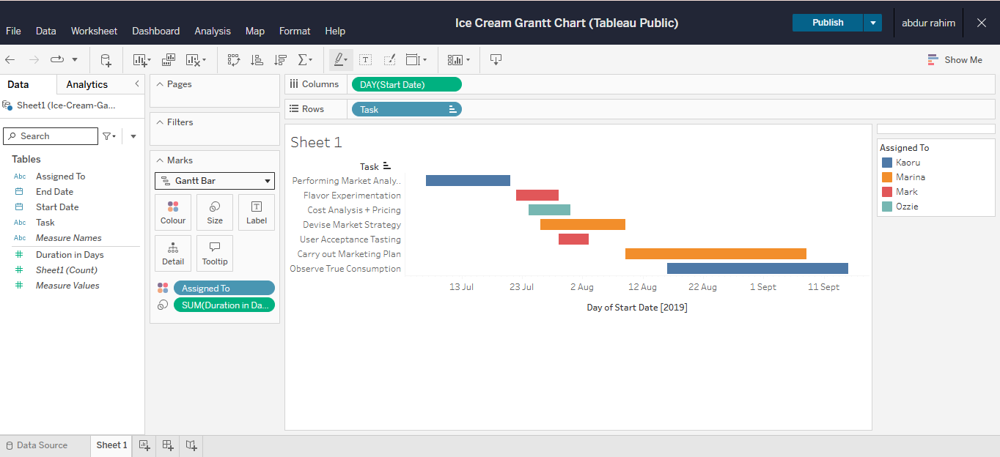

# Ice Cream Project Timeline | Tableau Gantt Chart

## Project Overview

This project demonstrates how Tableau can be used to visualize an ice cream project timeline through a Gantt chart.

The visualization provides an overview of project activities, scheduled start dates, task durations, and team assignments. It helps communicate project scheduling and understand how tasks are distributed across a timeline.

## Visualization Preview



## Key Features

- **Project Timeline:** Displays project activities across a date-based timeline.
- **Task Duration:** Uses Gantt bars to represent the duration of each activity.
- **Team Assignment:** Uses color coding to distinguish tasks assigned to different team members.
- **Task Overview:** Displays seven project activities in the timeline.

## Tableau Techniques

- Gantt Bar Chart
- Date Dimension
- Calculated Field: Duration in Days
- Color Encoding by Assigned To
- Date-Based Timeline Visualization

## Dataset Fields

| Field | Description |
|---|---|
| Task | Project activity name |
| Start Date | Scheduled task start date |
| End Date | Scheduled task end date |
| Duration in Days | Duration of each task |
| Assigned To | Team member responsible for the task |

## Tools & Skills

- Tableau Public
- Data Visualization
- Data Analysis
- Project Timeline Visualization

## Repository Structure

```text
ice-cream-gantt-chart/
├── Dashboard/
│   ├── Ice_Cream_Gantt_Chart.twbx
│   └── README.md
├── Images/
│   ├── gantt-chart-overview.png
│   └── README.md
└── README.md
```

## Interactive Visualization

**Tableau Public:** [View Interactive Gantt Chart](https://public.tableau.com/app/profile/abdur.rahim5381/viz/IceCreamGranttChart/Sheet1)

## Project Type

Independent learning and portfolio project.
